# DOKUMENTASI RESMI ENTITY RELATIONSHIP DIAGRAM (ERD) - SISTEM KASLY

> **Platform:** Kasly (Multi-Tenant Student Organization Financial Transparency Platform)  
> **Tema Lomba:** *Bayar Kas Tepat Waktu: Meningkatkan Kedisiplinan dan Transparansi Pembayaran Iuran/Kas*  
> **Status Skema:** Terverifikasi 100% Aman, Tervalidasi Migrasi & Model Eloquent, Siap Digunakan untuk Laporan & Presentasi.

---

## 1. Daftar Model & File Migrasi yang Valid untuk ERD

Seluruh model dan tabel di bawah ini sudah lulus pengujian migrasi, berelasi aktif di kode aplikasi Laravel, dan aman digunakan sebagai acuan perancangan ERD:

| No | Nama Tabel | Nama Model Eloquent | File Migrasi Terkait | Fungsi Utama |
|---|---|---|---|---|
| 1 | `organizations` | `App\Models\Organization` | `2026_11_07_000001_create_kas_universal_tables.php` `2026_11_07_081718_..._midtrans_columns_table.php` | Entitas Master Organisasi / Tenant ormawa |
| 2 | `users` | `App\Models\User` | `0001_01_01_000000_create_users_table.php` `2026_11_07_000002_add_username_to_users_table.php` `2026_11_07_000004_add_admin_role_to_users_table.php` `2026_11_07_000006_add_avatar_to_users_table.php` | Entitas akun login universal multi-peran |
| 3 | `organization_user` | Pivot Table | `2026_11_07_000001_create_kas_universal_tables.php` | Pivot Many-to-Many penugasan peran user di tenant |
| 4 | `members` | `App\Models\Member` | `2026_11_07_000001_create_kas_universal_tables.php` | Buku induk data mahasiswa/anggota ormawa |
| 5 | `dues_periods` | `App\Models\DuesPeriod` | `2026_11_07_000001_create_kas_universal_tables.php` | Periode penagihan kas mingguan/bulanan & due date |
| 6 | `dues_bills` | `App\Models\DuesBill` | `2026_11_07_000001_create_kas_universal_tables.php` `2026_11_07_081718_..._midtrans_columns_table.php` | Lembar kewajiban tagihan kas per anggota & status lunas |
| 7 | `cash_categories` | `App\Models\CashCategory` | `2026_11_07_000001_create_kas_universal_tables.php` | Kategori transaksi kas (Masuk/Keluar) |
| 8 | `transactions` | `App\Models\Transaction` | `2026_11_07_000001_create_kas_universal_tables.php` | Buku kas mutasi finansial (locked ledger) & bukti nota |
| 9 | `organization_payment_methods` | `App\Models\OrganizationPaymentMethod` | `2026_11_07_081718_..._midtrans_columns_table.php` | Saluran pembayaran mandiri (Cash, Bank, E-Wallet, QRIS) |
| 10 | `member_registration_tokens` | `App\Models\MemberRegistrationToken` | `2026_11_07_000005_create_member_registration_tokens_table.php` | Token QR code pendaftaran mandiri berbatas kuota & waktu |
| 11 | `organization_requests` | `App\Models\OrganizationRequest` | `2026_11_07_000003_create_organization_requests_table.php` | Formulir pengajuan ormawa publik dari landing page |
| 12 | `activity_logs` | `App\Models\ActivityLog` | `2026_11_07_000001_create_kas_universal_tables.php` | Rekam jejak audit aktivitas finansial permanen |

---

## 2. Diagram Visual ERD (Mermaid Notation)

```mermaid
erDiagram
    ORGANIZATIONS ||--o{ MEMBERS : "has (1:N)"
    ORGANIZATIONS ||--o{ DUES_PERIODS : "schedules (1:N)"
    ORGANIZATIONS ||--o{ TRANSACTIONS : "records (1:N)"
    ORGANIZATIONS ||--o{ CASH_CATEGORIES : "defines (1:N)"
    ORGANIZATIONS ||--o{ ORGANIZATION_PAYMENT_METHODS : "configures (1:N)"
    ORGANIZATIONS ||--o{ MEMBER_REGISTRATION_TOKENS : "issues (1:N)"
    ORGANIZATIONS ||--o{ ORGANIZATION_USER : "assigns (1:N)"
    ORGANIZATIONS ||--o{ ACTIVITY_LOGS : "audits (1:N)"

    USERS ||--o{ ORGANIZATION_USER : "belongs_to (1:N)"
    USERS ||--o| MEMBERS : "linked_account (1:1)"
    USERS ||--o{ DUES_PERIODS : "created_by (1:N)"
    USERS ||--o{ DUES_BILLS : "verified_by (1:N)"
    USERS ||--o{ TRANSACTIONS : "created_by (1:N)"
    USERS ||--o{ ORGANIZATION_REQUESTS : "approved_by (1:N)"

    DUES_PERIODS ||--o{ DUES_BILLS : "generates (1:N)"
    MEMBERS ||--o{ DUES_BILLS : "billed_to (1:N)"
    CASH_CATEGORIES ||--o{ TRANSACTIONS : "classified_in (1:N)"

    ORGANIZATIONS {
        bigint id PK
        string code UK "Kode Unik Ormawa"
        string name "Nama Ormawa"
        text description
        string status "active/inactive"
        boolean is_midtrans_enabled "Toggle Gateway"
        timestamp created_at
        timestamp updated_at
    }

    USERS {
        bigint id PK
        string name "Nama Lengkap"
        string username UK "Username Login"
        string email UK "Email Pengguna"
        string phone "No WhatsApp"
        string password "Hash Bcrypt"
        string avatar_path "Foto Profil"
        boolean is_super_admin "Flag Admin Pusat"
        string admin_role "super_admin/admin_penerima"
        timestamp created_at
        timestamp updated_at
    }

    ORGANIZATION_USER {
        bigint id PK
        bigint organization_id FK
        bigint user_id FK
        bigint member_id FK
        string role "admin_organisasi/bendahara/staff/anggota"
        boolean is_active
        timestamp created_at
        timestamp updated_at
    }

    MEMBERS {
        bigint id PK
        bigint organization_id FK
        bigint user_id FK
        string member_number "NIM / ID Anggota"
        string name "Nama Mahasiswa"
        string phone "No WhatsApp Anggota"
        boolean is_active
        timestamp created_at
        timestamp updated_at
    }

    DUES_PERIODS {
        bigint id PK
        bigint organization_id FK
        bigint created_by FK
        string title "Judul Periode Kas"
        decimal amount "Nominal Iuran"
        date due_date "Batas Jatuh Tempo"
        timestamp created_at
        timestamp updated_at
    }

    DUES_BILLS {
        bigint id PK
        bigint organization_id FK
        bigint dues_period_id FK
        bigint member_id FK
        bigint verified_by FK
        decimal amount "Nominal Kewajiban"
        string status "unpaid/pending/paid"
        boolean is_on_time "Tepat Waktu vs Terlambat"
        datetime paid_at "Waktu Pelunasan"
        string payment_method "cash/transfer/midtrans"
        string payment_channel "manual_cash/qris/va"
        string snap_token "Midtrans Snap"
        string midtrans_order_id "Midtrans Order ID"
        string proof_path "Bukti Transfer / Nota"
        timestamp created_at
        timestamp updated_at
    }

    CASH_CATEGORIES {
        bigint id PK
        bigint organization_id FK
        string name "Nama Kategori Kas"
        string type "in/out"
        timestamp created_at
        timestamp updated_at
    }

    TRANSACTIONS {
        bigint id PK
        bigint organization_id FK
        bigint category_id FK
        bigint created_by FK
        string type "in/out"
        decimal amount "Nominal Arus Kas"
        date transaction_date "Tanggal Transaksi"
        text description "Keterangan / Keperluan"
        string proof_path "Foto Nota / Struk Fisik"
        boolean is_locked "Proteksi Anti-Manipulasi"
        bigint reversal_of "Jejak Pembalik"
        timestamp created_at
        timestamp updated_at
    }

    ORGANIZATION_PAYMENT_METHODS {
        bigint id PK
        bigint organization_id FK
        string type "cash/bank/ewallet/qris"
        string channel_name "Nama Bank / Saluran"
        string account_number "No Rekening / HP"
        string account_holder "Atas Nama Pemilik"
        string qris_image_path "File Gambar QRIS"
        text instructions "Petunjuk Pembayaran"
        boolean is_active
        timestamp created_at
        timestamp updated_at
    }

    MEMBER_REGISTRATION_TOKENS {
        bigint id PK
        bigint organization_id FK
        bigint created_by FK
        string token UK "Token QR Code"
        integer max_uses "Batas Kuota"
        integer used_count "Kuota Terpakai"
        timestamp expires_at "Batas Kedaluwarsa"
        boolean is_active
        timestamp created_at
        timestamp updated_at
    }

    ORGANIZATION_REQUESTS {
        bigint id PK
        bigint approved_by FK
        string name "Nama Usulan Ormawa"
        string code "Usulan Kode"
        string pic_name "Nama Ketua / Pemohon"
        string pic_username "Username Pemohon"
        string pic_email "Email Resmi"
        string pic_phone "No WhatsApp"
        string status "pending/approved/rejected"
        datetime approved_at
        timestamp created_at
        timestamp updated_at
    }

    ACTIVITY_LOGS {
        bigint id PK
        bigint organization_id FK
        bigint user_id FK
        string action "Nama Aksi Sistem"
        string subject_type "Model Terkait"
        bigint subject_id "ID Subjek"
        json payload "Data Log Audit"
        timestamp created_at
        timestamp updated_at
    }
```

---

## 3. Kamus Data & Relasi Spesifik Antar-Entitas

### 1. Relasi Kunci Partisi Multi-Tenant
Setiap tabel operasional (`members`, `dues_periods`, `dues_bills`, `transactions`, `cash_categories`, `organization_payment_methods`, `member_registration_tokens`) menyimpan kunci partisi `organization_id` bertipe Foreign Key (`constrained()->cascadeOnDelete()`). Pola ini menjamin:
- **Zero Cross-Tenant Leakage**: Data kas antar ormawa tidak akan pernah bocor satu sama lain.
- **Pembersihan Data Otomatis**: Jika organisasi dihapus, seluruh data operasionalnya ikut terhapus secara beruntun (*cascade delete*).

### 2. Evaluasi Kedisiplinan (*On-Time Indicator*)
- Kunci evaluasi kedisiplinan berada pada perbandingan matematis antara `dues_periods.due_date` dengan `dues_bills.paid_at`.
- Nilai boolean `dues_bills.is_on_time`:
  - `TRUE` : Jika pelunasan dilakukan pada atau sebelum tanggal jatuh tempo (`paid_at <= due_date`).
  - `FALSE` : Jika pelunasan dilakukan setelah tanggal jatuh tempo (`paid_at > due_date`).
  - `NULL` : Tagihan belum lunas (`status` = `unpaid` / `pending`).
- Dari kolom ini, dashboard sistem menghitung **Tingkat Kepatuhan Tepat Waktu (%)** secara objektif dan real-time.

### 3. Integritas Pembukuan (*Locked Ledger & Anti-Manipulasi*)
- Kolom `transactions.is_locked = true` mencegah transaksi yang berasal dari pelunasan kas anggota dihapus sepihak oleh bendahara.
- Kolom `transactions.proof_path` menampung path foto nota/struk belanja fisik untuk mendukung transparansi penuh dan pemeriksaan fisik oleh anggota.

